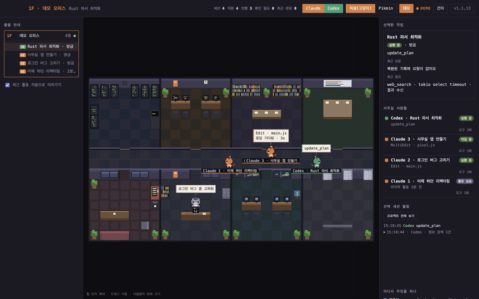

# Claude 오피스



Claude Code 세션이 지금 무엇을 하는지 사무실 캐릭터로 실시간으로 보여 주는 macOS 데스크톱 앱입니다.
토큰을 쓰지 않고, 로컬 기록 파일(`~/.claude/projects`)만 읽습니다.

## 실행

```bash
npm install
npm start
```

- 감시 폴더: `$CLAUDE_CONFIG_DIR/projects`, 없으면 `~/.claude/projects`
- **Codex**도 함께 읽습니다: `$CODEX_HOME/sessions`, 없으면 `~/.codex/sessions` (제목은 `session_index.jsonl`의 스레드 이름)
  - 같은 작업 폴더(cwd)라면 Claude와 같은 층에 모이고, Codex는 초록 고양이 / 초록 셔츠(`>_`)로 나옵니다.
  - Codex 도구 → 방: `exec_command`·`shell`은 서버실(단, `cat`·`rg`·`ls` 같은 읽기 명령은 자료실), `apply_patch`는 개발실, `web_search`·`web__run`·MCP는 정보검색실, `update_plan`은 회의실
- 기록이 없으면 빈 화면에서 **데모로 구경하기**를 누르면 됩니다. 상단 **데모** 버튼으로도 켜고 끌 수 있습니다.

## 화면 읽는 법

| 방 | 언제 가나 |
|---|---|
| 자료실 | Read · Grep · Glob · LS |
| 개발실 | Edit · Write · MultiEdit · NotebookEdit |
| 서버실 | Bash 계열 (활동이 많을수록 랙 LED가 빨리 깜빡임) |
| 정보검색실 | WebSearch · WebFetch · `mcp__*` |
| 회의실 | TodoWrite · Task · Agent · 플랜 모드 · Skill |
| 내 자리 | AskUserQuestion, 말한 뒤 3.5초 동안 도구를 안 쓰면 보고하러 옴 |
| 라운지 | 45초 동안 조용하면 쉬러 감 (응답 완료·오류도 포함, 질문하고 기다리는 중이면 자리에 남음) |
| 엘리베이터 로비 | 서브에이전트 출근·퇴근, 30분 조용하면 Claude도 퇴근 |

- 프로젝트마다 한 층, 한 층에 Claude가 여럿이면 `Claude 1`, `Claude 2`로 번호가 붙습니다.
- 도구 결과를 기다리는 동안 말풍선에 `고민 중… Ns`가 표시됩니다.
- 마지막 말이 질문이면(`…할까요?` 등) 내 자리로 와서 답할 때까지 기다립니다.
- 서브에이전트는 일이 끝나거나 45초 동안 조용하면 엘리베이터로 퇴근합니다.

## Pikmin 스타일

상단 토글 **Pikmin** 또는 단축키 `2`. 사무실이 정원이 되고 직원은 피크민이 됩니다.

- 방 → 구역: 서버실=전기 동굴, 개발실=다리 공사장, 자료실=낙엽 수풀, 회의실=작전 바위, 라운지=꽃밭 쉼터, 내 자리=캡틴 착륙선, 정보검색실=반짝 연못, 엘리베이터 로비=양파 착륙장
- 피크민 색(빨강·노랑·파랑)은 세션마다 랜덤입니다. 세션 ID로 정해서 앱을 다시 켜도 같은 색이고, 자기 색 양파에서 나와 자기 색 양파로 퇴근합니다.
- Claude는 이름표에 `✳`, Codex는 `>_`가 붙습니다. 나는 캡틴입니다.
- 도구를 많이 쓸수록 머리 위가 자랍니다: 잎(0~49회) → 봉오리(50~129회) → 꽃(130회~)
- 상하좌우 걷기 4프레임, 연못에서는 헤엄, 쉬는 중엔 zZ

> 피크민 정면 그림(`renderer/garden/`)은 핀터레스트에서 찾은 팬 픽셀아트(작가 미상)를 바탕으로 옆·뒷모습과 걷기를 더해 만들었습니다. 피크민은 닌텐도의 캐릭터이며 이 앱은 비공식 팬 프로젝트입니다. 문제가 되면 내리겠습니다.

## 조작

- 보기 선택: 상단 **Claude / Codex** 버튼으로 어떤 에이전트를 보여 줄지 고릅니다 (둘 다 끌 수는 없음, 설정은 저장됨)
- 스타일 전환: 상단 토글 또는 단축키 `1`(픽셀(고양이)) / `2`(Pikmin)
- 확대: 마우스 휠 · 트랙패드 핀치, 이동: 드래그, 원래 크기: 더블클릭
- 캐릭터 클릭: 선택 (오른쪽 목록에서도 선택 가능)
- 방향키: '나'(캡틴) 움직이기 — 누르고 있으면 계속, 두 키를 같이 누르면 대각선
- 메뉴 **보기 → 항상 위에 표시**

## 설치 (dmg)

[Releases](../../releases)에서 맥에 맞는 파일을 받으세요.

- Apple Silicon(M1 이후): `ClaudeOffice-x.y.z-arm64.dmg`
- Intel 맥: `ClaudeOffice-x.y.z-x64.dmg`

dmg를 열고 **Claude Office**를 응용 프로그램 폴더로 끌어다 놓으면 됩니다. (Dock과 메뉴에는 "Claude 오피스"로 보입니다.)

### 처음 실행할 때 (서명 안 된 앱)

Apple 개발자 서명이 없어서 처음 열면 "확인할 수 없음" 경고가 뜹니다.

1. 응용 프로그램 폴더에서 **Claude Office를 우클릭(Control+클릭) → 열기 → 열기**
2. 열기 버튼이 없으면(macOS 15 이후): **시스템 설정 → 개인정보 보호 및 보안** 맨 아래 **그래도 열기**
3. 그래도 "손상되었다"고 나오면 터미널에서 한 번 실행:
   ```bash
   xattr -cr "/Applications/Claude Office.app"
   ```

한 번 열고 나면 다음부터는 그냥 열립니다.

## 직접 빌드

```bash
npm run dist   # dist/ 에 arm64, x64 dmg 생성
npm run icon   # build/icon.png 다시 만들기
npm test       # 기록 파서 확인
```

- 번들 이름은 일부러 영문(`Claude Office`)입니다. 실행 파일 이름에 한글이 들어가면 Electron이 시작하자마자 종료됩니다.

## 참고

- `npm install` 뒤 `Electron failed to install correctly` 오류가 나면 Electron 바이너리 압축 해제가 실패한 것입니다.
  `node node_modules/electron/install.js`를 다시 실행하거나, `~/Library/Caches/electron/*/electron-*.zip`을
  `node_modules/electron/dist`에 풀고 `node_modules/electron/path.txt`에 `Electron.app/Contents/MacOS/Electron`을 적어 주세요.

## 작업 상황 보기

- 캐릭터 이름표에 세션 제목을 표시합니다. 제목이 없으면 최근 사용자 요청을 사용합니다.
- 오른쪽 상세 카드에는 선택한 작업의 요청, 현재 행동, 최근 도구 결과와 메시지가 나옵니다.
- 활동 로그는 기본적으로 선택한 세션만 표시합니다. 프로젝트 전체로 전환할 수 있고, 연속된 같은 종류의 활동은 펼쳐볼 수 있게 묶습니다.
- 상단 진행·확인 필요·최근 완료는 표시 중인 모든 프로젝트의 캐릭터 기준입니다. 최근 완료는 30분 이내의 명시적인 응답 종료입니다.
- 도구 실행은 `실행 중`, 질문 도구는 `입력 필요`, 실패 결과는 `오류 확인`으로 표시합니다. 10분 이상 도구 결과가 없으면 `상태 미확인`입니다.
- 완료 신호가 없는 메시지는 완료로 추측하지 않습니다. `응답 완료`는 작업 성공을 보장하는 표시가 아니라 에이전트의 응답이 끝났다는 뜻입니다.
- 상태 확인 테스트: `node test/office-state-check.js`
